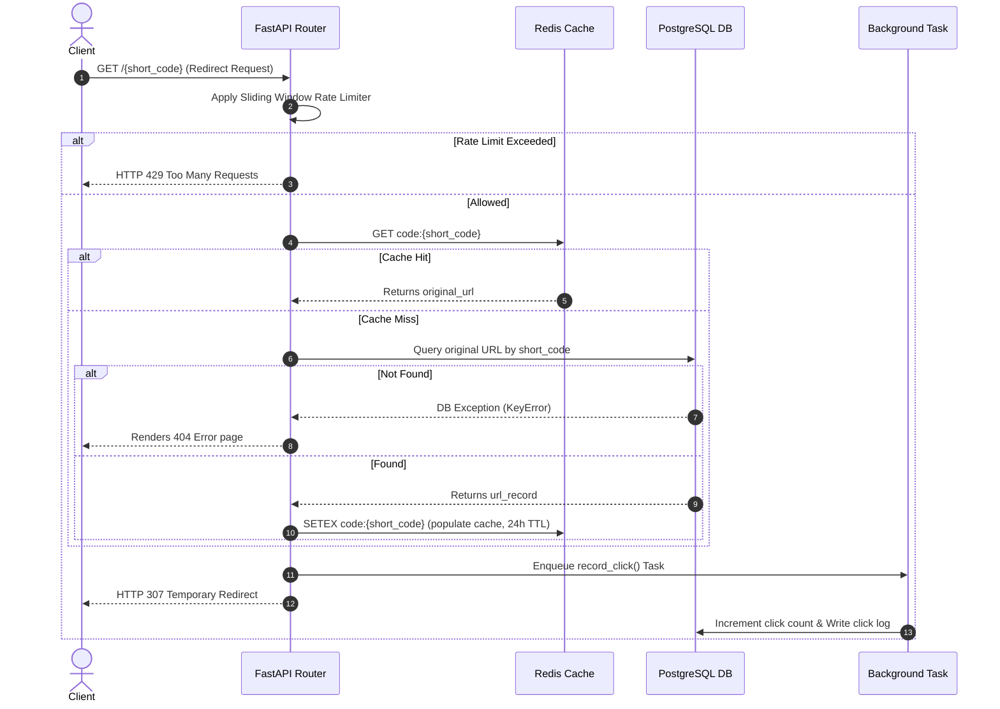

# OctoScale: URL Shortener with Redis Caching and Rate Limiting

[](https://render.com/deploy?repo=https://github.com/Charanloyal/octoscale-url-shortener)

OctoScale is a URL shortening service built on FastAPI, PostgreSQL and Redis. Short codes come from a Redis atomic counter (`INCR`) encoded in Base62, redirects are served from a Redis cache with a PostgreSQL fallback, click analytics are written in a FastAPI background task, and a sliding-window rate limiter on Redis sorted sets protects the API. The code uses a layered structure (routes → service → repository) with structured JSON logging.

A built-in dashboard lets users shorten links, copy them, and view click analytics for a code (a referrer breakdown chart and a table of recent clicks with a browser column parsed from the user agent).

**Status:** working single-instance service with a mocked-Redis/SQLite test suite. It is designed with throughput in mind (cached redirect path, deferred analytics writes), but **no load test has been run yet, so no throughput or latency figures are claimed** (see [Performance](#performance)).

---
## Live Demo

- Application: https://octoscale-web.onrender.com
- API documentation: https://octoscale-web.onrender.com/docs

The demo runs on Render's free tier and may take a while to wake up or be unavailable (it returned HTTP 503 when last checked).

## What Is Implemented

- Repository pattern with separate service and persistence layers
- Redis-backed atomic identifier generation (`INCR` + Base62)
- PostgreSQL fallback (`SELECT MAX(id)`) to re-seed the Redis counter if it is lost
- Sliding-window rate limiting with Redis sorted sets (fails open if Redis is unavailable)
- Click analytics recorded in a background task after the redirect is returned
- Structured JSON logging with `structlog`
- 20 automated tests (pytest, mocked Redis, in-memory SQLite); see [Testing and Coverage](#-testing-and-coverage)

## Performance

No benchmark has been run yet and no load-test script is committed, so this table is intentionally empty.

| Environment | Concurrent users | Throughput | p95 latency |
|---|---:|---:|---:|
| Not yet measured | — | — | — |

To produce real numbers, add a load-test script (for example Locust or k6) under `benchmarks/`, run it against `docker-compose up` on stated hardware, and commit the raw output alongside the table. Measure the cached redirect path (`GET /{short_code}`) and the create path (`POST /api/v1/shorten`) separately, and raise `RATE_LIMIT_PER_MINUTE` for the test, because the default of 100 requests/min per IP will otherwise return HTTP 429.


## 🏗️ System Architecture & Data Flow

OctoScale separates concerns through a classic layered OOP structure:
- **Presentation Layer**: FastAPI API routes, custom middlewares, and HTML template responders.
- **Service Layer (Business Logic)**: Manages Base62 hash-string calculations, rate limiting checks, cache coordination, and schedules background analytics logging.
- **Data Layer (Repository Pattern)**: Encapsulates database actions through generic repositories to maximize extensibility.

### Request Flow Diagram



---

## ⚡ Key Architecture Highlights

### 1. Counter-Based ID Generation
Instead of random hashes (which need collision checks), OctoScale uses a **Redis atomic counter** (`INCR`) to generate sequential IDs.
- These IDs are encoded into **Base62** strings (e.g. `10000001` becomes `P7Cv`), producing unique, short alphanumeric paths. The counter starts at 10,000,000, so generated codes are 4 characters until the counter passes 62⁴ (14,776,336).
- **Fallback**: If the Redis counter key is missing (e.g. Redis was flushed or restarted without persistence), the service queries `SELECT MAX(id)` from PostgreSQL, seeds the Redis counter, and continues from there.

### 2. Cached Redirects (Cache-Aside Reads, Cache Write on Create)
- When a short URL is created, the mapping is written to PostgreSQL and then to Redis (24-hour TTL).
- When a link is resolved, it reads from Redis first.
- On a cache miss it falls back to PostgreSQL, populates the Redis cache with a 24-hour TTL, and returns the redirect.
- To keep the redirect path short, **click tracking and analytics writes are deferred to FastAPI BackgroundTasks**: the redirect response is returned first and the database writes run afterwards in the same process.

### 3. Sliding Window Rate Limiter
Implemented via **Redis Sorted Sets (ZSET)**. Clients are limited (default: 100 requests/min per client IP, `RATE_LIMIT_PER_MINUTE`) using a sliding window (`zremrangebyscore`, `zadd`, `zcard` in one pipeline), which limits brute-force URL scraping and request floods from a single IP. If Redis is unreachable the limiter logs the error and lets the request through (fail-open).

---

## 🛠️ Tech Stack & Observability
- **Core**: Python 3.11+, FastAPI (Asynchronous API gateway)
- **Database**: PostgreSQL (Persistent metadata and relational analytics)
- **Object Relational Mapper**: SQLAlchemy 2.0 (Asyncpg driver)
- **Caching**: Redis (Rate limiting, ID generator, and hot-path resolution cache)
- **Containerization**: Docker & Docker Compose (Multi-stage builds)
- **Observability**: Structured logging with `structlog` (JSON output when `APP_ENV=production`), suitable for log aggregators
- **Testing**: Pytest with `pytest-asyncio`, `pytest-cov` and `pytest-mock` (in-process mock Redis and an in-memory SQLite database)

---

## ⚙️ Running Locally

### Prerequisites
- Docker and Docker Compose installed

### Start the Service (One Command)
```bash
docker-compose up --build
```
This launches:
1. **FastAPI Web Service** at `http://localhost:8000`
2. **PostgreSQL 15** database at `localhost:5432`
3. **Redis 7** cache at `localhost:6379`

The FastAPI startup lifecycle automatically creates the required PostgreSQL database tables.

---

## 🧪 Testing and Coverage

The test suite uses `pytest` with an in-process mock of Redis (`tests/conftest.py`) and an in-memory SQLite database via the async `aiosqlite` dialect, so it needs neither Redis nor PostgreSQL. Because of this, it does not exercise real Redis semantics (TTL expiry, pipelines/transactions) or PostgreSQL-specific behaviour.

### Run Tests locally
```bash
# Set up virtual environment
py -m venv .venv
.venv\Scripts\activate

# Install dependencies (C++ compiler not required for SQLite tests)
pip install fastapi uvicorn pydantic-settings "sqlalchemy[asyncio]" aiosqlite redis structlog jinja2 pytest pytest-asyncio pytest-cov httpx pytest-mock

# Run test suite with coverage
pytest --cov=app --cov-report=term-missing tests/
```

### Coverage Report
Output below was recorded by the author (20 test functions exist in `tests/`); it is not generated in CI, so re-run the command above to reproduce it.
```
=============================== tests coverage ================================
Name                                 Stmts   Miss  Cover   Missing
------------------------------------------------------------------
app\__init__.py                          0      0   100%
app\api\__init__.py                      0      0   100%
app\api\dependencies.py                 34      4    88%   27, 50-51, 57
app\api\v1\__init__.py                   2      0   100%
app\api\v1\endpoints.py                 45      2    96%   52-53
app\config.py                           11      0   100%
app\database.py                         21     10    52%   10-11, 34-42
app\logger.py                           13      1    92%   18
app\main.py                             60     18    70%   20-39, 73-82, 94
app\models\__init__.py                   3      0   100%
app\models\url.py                       22      0   100%
app\redis.py                            26      8    69%   19-21, 30-32, 37-38
app\repositories\__init__.py             2      0   100%
app\repositories\base.py                26      0   100%
app\repositories\url_repository.py      21      0   100%
app\schemas\__init__.py                  2      0   100%
app\schemas\url.py                      29      3    90%   14, 25, 27
app\services\__init__.py                 2      0   100%
app\services\url_service.py             89     10    89%   57, 82-85, 121-125, 142
------------------------------------------------------------------
TOTAL                                  408     56    86%
======================== 20 passed, 1 warning in 0.78s ========================
```

---

## Deployment

The service is a single Docker image (`Dockerfile`) that needs a PostgreSQL database and a Redis instance, configured through `DATABASE_URL`, `REDIS_URL`, `BASE_URL` and `APP_ENV` (see `.env.example`). A `postgresql://` URL is rewritten to the `postgresql+asyncpg://` driver automatically.

### Render (Blueprint)
The repository includes a `render.yaml` Blueprint that defines the web service (Docker), a Render Key Value (Redis-compatible) instance and a PostgreSQL database, all on the free plan. Create a new **Blueprint** on Render, point it at this repository, and update `BASE_URL` in `render.yaml` to your service URL.

### Railway
1. Create a project from this GitHub repository; Railway builds the `Dockerfile`.
2. Add PostgreSQL and Redis services from the dashboard.
3. Set the environment variables on the web service:
   - `DATABASE_URL` = `${{Postgres.DATABASE_URL}}`
   - `REDIS_URL` = `${{Redis.REDIS_URL}}`
   - `BASE_URL` = `https://<your-railway-app-name>.up.railway.app`
   - `APP_ENV` = `production`

---

## Limitations

- **No load test or benchmark yet** – throughput and latency are unmeasured.
- **Single instance** – background click recording runs in the web process (FastAPI `BackgroundTasks`), not a durable queue; clicks in flight are lost if the process stops.
- **Schema management** – tables are created with `create_all` on startup; there are no migrations (e.g. Alembic).
- **Analytics endpoint** loads all click rows for a URL and sorts them in memory before returning the latest 100, which will slow down for very popular links.
- **Custom codes vs generated codes** – a custom code is not reserved against future counter values, so a custom 4-character code could later collide with a generated one (rejected by the unique constraint on `short_code`).
- **Client IP behind a proxy** – the rate limiter keys on `request.client.host`; behind a reverse proxy (e.g. Render) uvicorn must be configured to trust forwarded headers, otherwise clients may share one limit.
- **Tests use mocks** – Redis is mocked and SQLite replaces PostgreSQL; there is no CI workflow or integration test against real services.